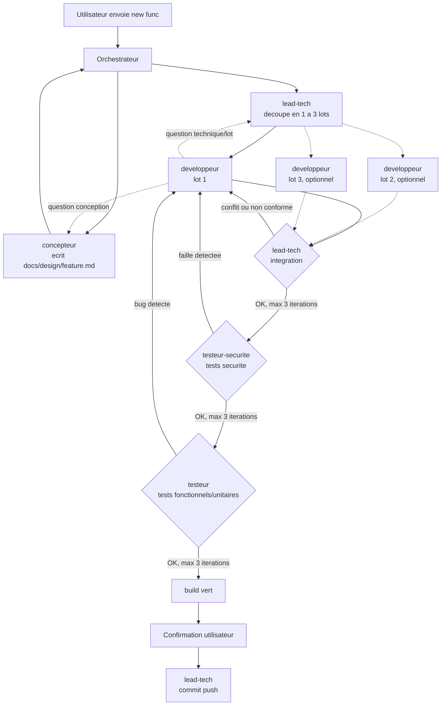

# Instructions personnalisées pour GitHub Copilot

**Lis d'abord [`AGENTS.md`](../AGENTS.md)** à la racine du dépôt : il centralise
l'architecture, les conventions de code, les tests et le tooling de build, avec des
liens vers des documents détaillés dans `docs/agents/`.

## Build & validation
Avant de considérer une tâche terminée, exécuter au minimum `<commande de tests>`, ou
`<commande de build>` pour une vérification complète. Les commandes réelles du projet
sont décrites dans `docs/agents/build-and-tooling.md` et `docs/agents/testing.md`.

## Orchestration multi-agents "new func"

Ce workflow est **spécifique à ce dépôt** : les agents sont définis dans
`.github/agents/` (portée dépôt uniquement, pas de configuration globale).

Dès qu'un message utilisateur contient la phrase déclencheuse **"new func"**, l'agent
principal de la session agit comme **orchestrateur** et enchaîne les 5 agents suivants,
en les invoquant explicitement (`Use the <agent> agent to ...`) :

1. **`concepteur`** — conçoit un plan de conception pour la fonctionnalité demandée et
   l'écrit dans `docs/design/<feature>.md` (seul fichier qu'il peut créer/modifier). Il
   ne touche jamais au code applicatif ni aux tests.
   - Il peut avoir un **avis critique** sur la demande (risque, incohérence avec la
     philosophie du produit, dérive de périmètre...) et la challenger via des questions
     avant d'écrire le plan. L'orchestrateur relaie cet avis à l'utilisateur. Si
     l'utilisateur force la main, le concepteur rédige le plan quand même en consignant
     sa réserve dans le document.
2. **`lead-tech` (découpage)** — lit le plan et décide s'il faut un seul développeur
   (fonctionnalité petite/moyenne) ou 2-3 **lots** parallèles (fonctionnalité
   volumineuse). En cas de découpage, il écrit `docs/design/<feature>-lots.md` :
   périmètre de fichiers **exclusif** par lot (zéro chevauchement) + contrats/interfaces
   partagés entre lots.
3. **`developpeur`** implémente le code applicatif d'après le plan (et le lot assigné).
   Pour une fonctionnalité découpée en plusieurs lots, l'orchestrateur lance **1 à 3
   instances de `developpeur` en parallèle**, une par lot, chacune limitée au périmètre
   de fichiers de son lot.
   - Question de conception/produit → relayée au concepteur. Question technique ou
     inter-lot (contrat d'interface, dépendance entre lots) → relayée à `lead-tech`.
4. **`lead-tech` (intégration)** — une fois tous les lots terminés, vérifie l'absence de
   conflit de fichiers entre lots, lance un build (`<commande de build>`), et relit le
   code produit pour sa conformité aux conventions du projet
   (`docs/agents/conventions.md`, `AGENTS.md`).
   - **Boucle de correction intégration** (max **3 itérations**) : en cas de conflit,
     build cassé ou non-conformité, il rédige un rapport transmis (par l'orchestrateur)
     au(x) développeur(s) concerné(s), qui corrige(nt) puis redemande(nt) une nouvelle
     intégration. Au-delà de 3 itérations sans succès, l'orchestrateur s'arrête et
     remonte le problème à l'utilisateur.
5. **Tests de sécurité**, une fois l'intégration validée : le code est envoyé à
   `testeur-securite`, qui rédige/exécute des tests de sécurité portant sur le **code
   réellement implémenté** (stockage, configuration/permissions, secrets en dur, réseau,
   logs).
   - **Boucle de correction sécurité** (max **3 itérations**) : même mécanique que la
     boucle d'intégration, rapport → correctif développeur → retest.
6. **Une fois la sécurité validée**, `testeur` rédige/exécute les tests
   fonctionnels/unitaires **d'après le plan de conception** (pas d'après le code
   produit).
   - **Boucle de correction fonctionnelle** (max **3 itérations**), même mécanique que
     les boucles précédentes.
7. Une fois intégration + sécurité + tests fonctionnels + build au vert, l'orchestrateur
   **demande confirmation à l'utilisateur** avant de déclencher **`lead-tech` (commit)**,
   qui rédige le message de commit et exécute `git add`/`commit`/`push` (la passphrase
   SSH est saisie directement par l'utilisateur au moment du push, jamais transmise
   entre agents).

Dans toutes les boucles, si un agent a une question sur le plan, l'orchestrateur la
relaie au concepteur ; si la question porte sur le découpage/l'intégration technique,
elle est relayée à `lead-tech`.

### Mode liste de fonctionnalités (backlog)

En plus d'une fonctionnalité unique, l'invocation "new func" accepte une **liste** de
plusieurs fonctionnalités à implémenter, fournie soit **directement dans le prompt**
(une par ligne/puce), soit via un **fichier `.md`** référencé par l'utilisateur
(liste à puces ou checklist `- [ ] ...`).

Dans ce mode, l'orchestrateur :
- traite les fonctionnalités **séquentiellement**, une par une (le parallélisme à 1-3
  devs décrit ci-dessus reste interne à chaque fonctionnalité, il ne s'applique pas
  entre plusieurs fonctionnalités de la liste) ;
- exécute pour chacune le **pipeline complet** (étapes 1 à 7 ci-dessus) jusqu'au
  commit inclus par `lead-tech`, mais **sans jamais appeler `git push`** ;
- **n'attend pas de confirmation utilisateur avant chaque commit individuel** : fournir
  la liste vaut accord global pour enchaîner automatiquement (une confirmation
  ponctuelle reste possible au cas par cas pour une ambiguïté réelle) ;
- si le pipeline d'une fonctionnalité échoue au-delà du nombre maximal d'itérations (3),
  **arrête le traitement de la liste**, rapporte le problème à l'utilisateur, et
  n'enchaîne pas sur les fonctionnalités suivantes tant que l'utilisateur n'a pas
  tranché ;
- si la liste provient d'un fichier checklist (`- [ ] ...`), **coche l'élément**
  (`- [x] ...`) une fois son commit effectué, en incluant cette modification dans le
  commit correspondant ; si la liste est inline dans le prompt, récapitule simplement
  ce qui a été fait en fin de traitement ;
- une fois toute la liste traitée (ou arrêtée sur erreur), résume les commits
  effectués et rappelle explicitement que le **push final** reste à faire par
  l'utilisateur.

### Schéma du workflow

Voir les fichiers `.github/agents/*.agent.md` pour le détail des rôles, outils
autorisés et limites de chaque agent.
