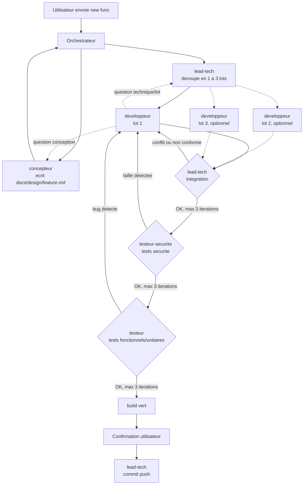

# Instructions personnalisées (GitHub Copilot et Claude Code)

Ce fichier est la source unique des règles d'orchestration. Copilot le lit directement ;
Claude Code l'importe depuis [`CLAUDE.md`](../CLAUDE.md). Les agents
`.github/agents/` (Copilot) et `.claude/agents/` (Claude Code) sont synchronisés dans les
deux sens par `node scripts/sync-agents.mjs` : on peut éditer l'un ou l'autre.

**Lis d'abord [`AGENTS.md`](../AGENTS.md)** à la racine du dépôt : il centralise
l'architecture, les conventions de code, les tests et le tooling de build, avec des
liens vers des documents détaillés dans `docs/agents/`.

## Build & validation
Avant de considérer une tâche terminée, exécuter au minimum `<commande de tests>`, ou
`<commande de build>` pour une vérification complète. Les commandes réelles du projet
sont décrites dans `docs/agents/build-and-tooling.md` et `docs/agents/testing.md`.

## Orchestration multi-agents "new func"

Ce workflow est **spécifique à ce dépôt** : les agents sont définis dans
`.github/agents/` (portée dépôt uniquement, pas de configuration globale).

Dès qu'un message utilisateur contient la phrase déclencheuse **"new func"**, l'agent
principal de la session agit comme **orchestrateur** et enchaîne les 5 agents suivants,
en les invoquant explicitement (`Use the <agent> agent to ...`) :

1. **`concepteur`** — conçoit un plan de conception pour la fonctionnalité demandée et
   l'écrit dans `docs/design/<feature>.md` (seul fichier qu'il peut créer/modifier). Il
   ne touche jamais au code applicatif ni aux tests.
   - Il peut avoir un **avis critique** sur la demande (risque, incohérence avec la
     philosophie du produit, dérive de périmètre...) et la challenger via des questions
     avant d'écrire le plan. L'orchestrateur relaie cet avis à l'utilisateur. Si
     l'utilisateur force la main, le concepteur rédige le plan quand même en consignant
     sa réserve dans le document.
2. **`lead-tech` (découpage)** — lit le plan et décide s'il faut un seul développeur
   (fonctionnalité petite/moyenne) ou 2-3 **lots** parallèles (fonctionnalité
   volumineuse). En cas de découpage, il écrit `docs/design/<feature>-lots.md` :
   périmètre de fichiers **exclusif** par lot (zéro chevauchement) + contrats/interfaces
   partagés entre lots.
3. **`developpeur`** implémente le code applicatif d'après le plan (et le lot assigné).
   Pour une fonctionnalité découpée en plusieurs lots, l'orchestrateur lance **1 à 3
   instances de `developpeur` en parallèle**, une par lot, chacune limitée au périmètre
   de fichiers de son lot.
   - Question de conception/produit → relayée au concepteur. Question technique ou
     inter-lot (contrat d'interface, dépendance entre lots) → relayée à `lead-tech`.
4. **`lead-tech` (intégration)** — une fois tous les lots terminés, vérifie l'absence de
   conflit de fichiers entre lots, lance un build (`<commande de build>`), et relit le
   code produit pour sa conformité aux conventions du projet
   (`docs/agents/conventions.md`, `AGENTS.md`).
   - **Boucle de correction intégration** (max **3 itérations**) : en cas de conflit,
     build cassé ou non-conformité, il rédige un rapport transmis (par l'orchestrateur)
     au(x) développeur(s) concerné(s), qui corrige(nt) puis redemande(nt) une nouvelle
     intégration. Au-delà de 3 itérations sans succès, l'orchestrateur s'arrête et
     remonte le problème à l'utilisateur.
5. **Tests de sécurité**, une fois l'intégration validée : le code est envoyé à
   `testeur-securite`, qui rédige/exécute des tests de sécurité portant sur le **code
   réellement implémenté** (stockage, configuration/permissions, secrets en dur, réseau,
   logs).
   - **Boucle de correction sécurité** (max **3 itérations**) : même mécanique que la
     boucle d'intégration, rapport → correctif développeur → retest.
6. **Une fois la sécurité validée**, `testeur` rédige/exécute les tests
   fonctionnels/unitaires **d'après le plan de conception** (pas d'après le code
   produit).
   - **Boucle de correction fonctionnelle** (max **3 itérations**), même mécanique que
     les boucles précédentes.
7. Une fois intégration + sécurité + tests fonctionnels + build au vert, l'orchestrateur
   **demande confirmation à l'utilisateur** avant de déclencher **`lead-tech` (commit)**,
   qui rédige le message de commit et exécute `git add`/`commit`/`push` (la passphrase
   SSH est saisie directement par l'utilisateur au moment du push, jamais transmise
   entre agents).

Dans toutes les boucles, si un agent a une question sur le plan, l'orchestrateur la
relaie au concepteur ; si la question porte sur le découpage/l'intégration technique,
elle est relayée à `lead-tech`.

### Choix du modèle selon la complexité

But : ne payer un modèle haut de gamme que là où il sert. Trois niveaux, du moins cher au
plus cher : **léger** (`haiku`), **standard** (`sonnet`), **avancé** (`opus`).

Lors du découpage, `lead-tech` note chaque lot (ou la fonctionnalité entière s'il n'y a
qu'un développeur) `S`, `M` ou `L`. L'orchestrateur choisit ensuite le modèle de chaque
invocation :

| Agent | Modèle |
|---|---|
| `concepteur` | avancé, toujours |
| `lead-tech` (découpage, relais, intégration) | standard, toujours |
| `lead-tech` (commit) | léger, toujours |
| `developpeur` | selon la note de son lot : `S` → léger, `M` → standard, `L` → avancé |
| `testeur` | selon la note la plus haute parmi les lots, même correspondance |
| `testeur-securite` | comme `testeur`, mais jamais en dessous de standard |

**Escalade dans les boucles de correction** : la première tentative de correction du
`developpeur` utilise le modèle de son lot ; à partir de la 2ᵉ itération d'une même
boucle, un niveau au-dessus (plafonné à avancé). Le compteur repart du modèle du lot à
chaque nouvelle boucle (intégration, sécurité, fonctionnelle).

Si la note manque dans la réponse de `lead-tech`, l'orchestrateur la lui redemande plutôt
que de la deviner.

Mise en œuvre : sous Claude Code, le modèle par défaut de chaque agent est la ligne
`model:` de `.claude/agents/<agent>.md`, et l'orchestrateur le surcharge par invocation
avec le paramètre `model` de l'outil Agent. Sous Copilot, le modèle par défaut est la
ligne `model:` de `.github/agents/<agent>.agent.md`. Appliquer la même règle de
surcharge si l'outil permet de choisir le modèle par invocation ; sinon, le modèle par
défaut de l'agent s'applique.

`scripts/sync-agents.mjs` convertit le modèle d'un format à l'autre : alias Claude Code
(`opus`, `sonnet`, `haiku`) d'un côté, nom affiché par Copilot (`"Claude Opus 5.5"`…)
de l'autre. De même, `effort:` côté Claude Code devient `reasoning-effort:` côté
Copilot. Les noms Copilot sont dans la table `MODEL_TO_COPILOT` du script, à mettre à
jour à chaque nouvelle version de modèle.

### Mode liste de fonctionnalités (backlog)

En plus d'une fonctionnalité unique, l'invocation "new func" accepte une **liste** de
plusieurs fonctionnalités à implémenter, fournie soit **directement dans le prompt**
(une par ligne/puce), soit via un **fichier `.md`** référencé par l'utilisateur
(liste à puces ou checklist `- [ ] ...`).

Dans ce mode, l'orchestrateur :
- traite les fonctionnalités **séquentiellement**, une par une (le parallélisme à 1-3
  devs décrit ci-dessus reste interne à chaque fonctionnalité, il ne s'applique pas
  entre plusieurs fonctionnalités de la liste) ;
- exécute pour chacune le **pipeline complet** (étapes 1 à 7 ci-dessus) jusqu'au
  commit inclus par `lead-tech`, mais **sans jamais appeler `git push`** ;
- **n'attend pas de confirmation utilisateur avant chaque commit individuel** : fournir
  la liste vaut accord global pour enchaîner automatiquement (une confirmation
  ponctuelle reste possible au cas par cas pour une ambiguïté réelle) ;
- si le pipeline d'une fonctionnalité échoue au-delà du nombre maximal d'itérations (3),
  **arrête le traitement de la liste**, rapporte le problème à l'utilisateur, et
  n'enchaîne pas sur les fonctionnalités suivantes tant que l'utilisateur n'a pas
  tranché ;
- si la liste provient d'un fichier checklist (`- [ ] ...`), **coche l'élément**
  (`- [x] ...`) une fois son commit effectué, en incluant cette modification dans le
  commit correspondant ; si la liste est inline dans le prompt, récapitule simplement
  ce qui a été fait en fin de traitement ;
- une fois toute la liste traitée (ou arrêtée sur erreur), résume les commits
  effectués et rappelle explicitement que le **push final** reste à faire par
  l'utilisateur.

## Orchestration "new todolist"

Dès qu'un message utilisateur contient la phrase déclencheuse **"new todolist"**, suivie
d'une liste d'items (une par ligne/puce dans le prompt, ou un fichier `.md` en liste à
puces ou checklist `- [ ] ...`), l'orchestrateur intègre les items **un par un, dans
l'ordre donné**, sauf si la liste passe en **mode parallèle** (section 5). Chaque item suit la **voie la plus légère qui garantit la qualité** :
le pipeline n'est pas le même pour une faute de frappe et pour une fonctionnalité.

Les règles du mode liste de "new func" s'appliquent telles quelles : un commit par item
par `lead-tech`, **jamais de `git push`**, pas de confirmation avant chaque commit, case
cochée dans le commit de l'item si la liste vient d'une checklist, arrêt de la liste si
un item échoue au-delà de 3 itérations, récapitulatif final et rappel du push.

### 1. Tri des items

Avant de lancer le moindre agent, l'orchestrateur classe chaque item lui-même (sans
sous-agent) et annonce le classement à l'utilisateur en une ligne par item, sans attendre
de validation :

| Voie | Critères |
|---|---|
| **express** | Aucune nouvelle logique : faute de frappe, texte, renommage, valeur de configuration, mise à jour de doc. 1-2 fichiers, demande sans ambiguïté, aucune surface sensible. |
| **courte** | Logique nouvelle mais locale et bornée, qui suit un pattern déjà présent dans le projet. Un seul développeur, pas de décision d'architecture. |
| **complète** | Tout le reste : nouvelle fonctionnalité, changement transverse, modèle de données, nouveau pattern, ou demande ambiguë. |

**Surface sensible** : stockage de données, réseau, authentification/permissions,
secrets, logs, traitement d'une entrée utilisateur. Un item qui y touche n'est jamais en
voie express.

En cas de doute entre deux voies, prendre la plus lourde. Un item trop vague pour être
classé donne lieu à une question à l'utilisateur, posée au moment du tri pour tous les
items concernés en une fois.

### 2. Pipeline par voie

| Étape | express | courte | complète |
|---|---|---|---|
| `concepteur` | non | plan court (modèle standard) | oui |
| `lead-tech` découpage | non | non | oui |
| `developpeur` | léger, d'après l'item | léger, d'après le plan court | selon la note `S`/`M`/`L` |
| `lead-tech` intégration | fusionnée avec le commit | oui | oui |
| `testeur-securite` | non | si surface sensible | oui |
| `testeur` | léger, tests existants + test de non-régression si utile | léger, d'après le plan court | selon la note |
| `lead-tech` commit | standard, revue + build + commit en une invocation | léger | léger |

- **Voie express** : `developpeur` → `testeur` → `lead-tech`. Pas de document dans
  `docs/design/`. `lead-tech` relit le diff, lance le build et committe dans la même
  invocation ; s'il refuse le diff, il ne committe pas et son rapport repart au
  `developpeur` (boucle de 3 itérations).
- **Voie courte** : le plan court tient en 40 lignes au plus (résumé, fichiers touchés,
  comportement attendu, cas de test). Le droit de challenge du concepteur reste entier.
  C'est `lead-tech`, à l'intégration, qui dit si le diff touche une surface sensible et
  donc si `testeur-securite` doit passer.
- **Voie complète** : étapes 1 à 7 de "new func", avec les modèles de la section « Choix
  du modèle selon la complexité ».

L'escalade de modèle dans les boucles de correction s'applique dans les trois voies.

### 3. Garde-fous qualité

- Le build et la suite de tests tournent pour **chaque** item, quelle que soit la voie.
- **Reclassement** : tout agent qui constate que l'item dépasse sa voie (logique plus
  large que prévu, surface sensible découverte, ambiguïté) le signale. L'orchestrateur
  passe l'item dans la voie supérieure et reprend à la première étape manquante, sans
  refaire ce qui est déjà valide. On ne reclasse jamais vers une voie plus légère en
  cours de route.
- Un item en voie express ou courte qui épuise ses 3 itérations de correction est
  reclassé une fois en voie supérieure avant d'être déclaré en échec.

### 4. Économie de contexte

- L'orchestrateur transmet aux agents des **chemins** (plan, fichiers, rapport), jamais
  de contenu recopié. En voie express, le texte de l'item suffit.
- Il demande à chaque agent un **rapport court** : verdict `OK`/`KO` sur la première
  ligne, puis au plus 15 lignes (`fichier:ligne`, problème, correctif attendu). Pas de
  récapitulatif du travail effectué.
- En boucle de correction, seul le dernier rapport d'échec est transmis au `developpeur`.
- Une fois un item committé, l'orchestrateur n'en garde qu'une ligne (item, voie, hash
  du commit) et ne réutilise aucun détail de cet item pour les suivants.
- Chaque invocation ne lance que les agents de la voie ; aucun agent « pour avis ».

### 5. Mode parallèle (listes longues)

Quand la liste compte **au moins 4 items**, plusieurs items peuvent être développés en
même temps, par **1 à X développeurs**. X vaut **3 par défaut** ; l'utilisateur peut le
changer dans son message (`new todolist max-devs=5`). En dessous de 4 items, ou si
l'outil ne sait pas lancer d'agents en parallèle, le traitement reste séquentiel.

**Préparation** (après le tri) :
1. `concepteur` rédige les plans (courts ou complets) de tous les items non express. Les
   plans portent sur des fichiers distincts : les invocations peuvent tourner en
   parallèle.
2. `lead-tech` (standard) **planifie les vagues** dans
   `docs/design/<liste>-vagues.md`, en une seule invocation. Ce document remplace le
   découpage par item de la voie complète. Pour chaque item, il donne :
   - un identifiant `T1`, `T2`… dans l'ordre de la liste ;
   - le **périmètre de code** et le **périmètre de tests**, exclusifs : aucun fichier
     partagé avec un autre item de la même vague ;
   - la note `S`/`M`/`L` et, pour un item de voie complète, ses lots éventuels ;
   - la vague de l'item.
3. Règles des vagues :
   - deux items qui touchent un même fichier, ou dont l'un dépend de l'autre, vont dans
     des vagues différentes, dans l'ordre de la liste ;
   - une vague compte au plus X développeurs en même temps, lots compris ;
   - le fichier checklist de la liste n'appartient à aucun périmètre : seul `lead-tech`
     le modifie, au commit.

L'orchestrateur annonce les vagues en une ligne chacune (`Vague 1 : T1, T3, T4`), sans
attendre de validation.

**Déroulé d'une vague** :
1. Un `developpeur` par item (ou par lot), tous lancés en parallèle. Chacun reçoit
   l'identifiant de son item, le chemin de son plan, le chemin du fichier des vagues, et
   ne touche que son périmètre de code.
2. `lead-tech` fait **une intégration pour toute la vague** : conflits, build, revue par
   item, et `Surface sensible : oui/non` pour chaque item. Son rapport range les
   problèmes par identifiant d'item. Seuls les développeurs des items `KO` repartent en
   correction.
3. `testeur-securite` puis `testeur` : **une invocation par item**, en parallèle. Chaque
   testeur ne reçoit qu'un seul item. Il écrit ses tests uniquement dans le périmètre de
   tests de cet item et ne lance que ces tests (`<commande de tests ciblée>`). Un échec
   hors de son périmètre n'est pas un bug de son item : il le signale sur une ligne
   `Hors périmètre :`, et l'orchestrateur le transmet à `lead-tech`.
4. `lead-tech` (léger) committe les items validés **un par un**, dans l'ordre de la
   liste. Pour chaque commit, il ajoute uniquement les fichiers du périmètre de l'item
   (`git add <fichiers>`, jamais `git add .`) et coche sa case. Avant le premier commit
   de la vague, il lance la suite de tests **complète** : c'est elle qui détecte une
   interaction entre items.
5. La vague suivante ne démarre qu'une fois tous les items de la vague committés.

**Échec dans une vague** : si un item épuise ses itérations, les autres items de la
vague vont jusqu'au commit, sauf ceux qui en dépendent. Les fichiers de l'item en échec
restent non committés. L'orchestrateur s'arrête avant la vague suivante et remonte le
problème à l'utilisateur.

**Rapports** : la première ligne de tout rapport d'un agent en mode parallèle est
`T<n> OK` ou `T<n> KO`. Le rapport d'intégration de vague a une ligne par item.

### 6. Suivi de la consommation

L'orchestrateur suit la consommation de chaque invocation, en mode séquentiel comme en
mode parallèle. Le mode parallèle ne consomme pas plus au total, mais il consomme plus
vite : il épuise plus tôt un quota par fenêtre de temps.

**Budget** : l'utilisateur peut le donner dans son message (`budget=2M`, en tokens).
Sans budget, l'orchestrateur suit quand même la consommation et l'affiche, sans seuil
d'arrêt.

**Mesure** :
- sous Claude Code, le résultat de chaque invocation de l'outil Agent donne son total de
  tokens : l'orchestrateur l'additionne ;
- si l'outil ne donne pas de compte, l'orchestrateur compte les invocations, pondérées
  par niveau de modèle : léger 1, standard 3, avancé 5. Le budget s'exprime alors dans
  cette unité.

**Journal** : l'orchestrateur tient `.orchestration/suivi-<liste>.md` (ignoré par git).
Une ligne par invocation : item, agent, modèle, consommation, cumul. Une ligne par item
terminé : statut et hash du commit. Ce journal permet de reprendre une liste
interrompue avec `reprendre todolist <liste>`.

**Estimation** : avant de lancer une vague (ou un item en mode séquentiel),
l'orchestrateur estime son coût : moyenne de la consommation des items déjà faits de
même note, sinon S = 1, M = 3, L = 8 fois le coût moyen d'une invocation légère
observée.

**Seuils** (en part du budget consommé) :

| Seuil | Action |
|---|---|
| 50 % | Une ligne à l'utilisateur : consommé, restant, items restants. |
| 75 % | Plus de parallélisme : les vagues suivantes passent à 1 développeur. Plus d'escalade de modèle au-delà de standard dans les boucles de correction ; un item qui en aurait besoin est déclaré en échec. |
| 90 % | Aucun nouvel item : l'orchestrateur termine et committe les items en cours, puis s'arrête. |

Un item ou une vague dont l'estimation dépasse le budget restant n'est pas lancé :
l'orchestrateur s'arrête et le signale.

**Limite atteinte en cours de route** : si une invocation échoue pour quota ou limite de
débit, l'orchestrateur ne la relance pas en boucle. Il note l'état dans le journal,
s'arrête, et indique à l'utilisateur la commande de reprise.

### 7. Récapitulatif final

Un tableau : item, voie (et reclassement éventuel), vague en mode parallèle, nombre
d'itérations de correction, consommation, hash du commit. Puis la consommation totale
(et la part du budget), et le rappel que le push reste à faire par l'utilisateur.

### Schéma du workflow

Voir les fichiers `.github/agents/*.agent.md` pour le détail des rôles, outils
autorisés et limites de chaque agent.
